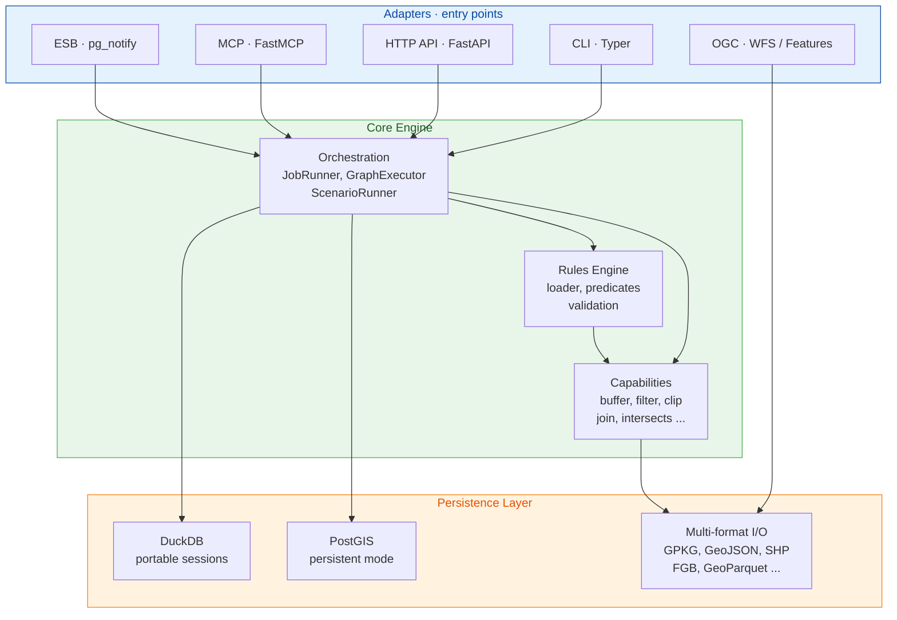
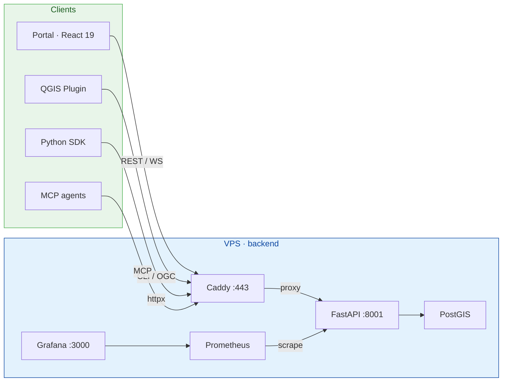

<p align="center">
  
</p>

<h1 align="center">GISPulse — French &amp; Belgian open geodata, ready to run.</h1>

<p align="center">
  <strong>22 open-data sources (cadastre, DVF, PLU/GPU, BAN, Géorisques, INSEE, IGN, RNB, BDNB… and GRB/PICC/UrbIS/Statbel for Belgium), 20+ business workflow templates (ZAN land-take, PLU/CNIG validation, flood-risk exposure, DVF market, FTTH hotspots, SDIS coverage…), 144 spatial capabilities, DuckDB inside — no server needed.<br>Save in QGIS, your rules fire.</strong>
</p>

[](https://pypi.org/project/gispulse/)
[](https://pypi.org/project/gispulse/)
[](LICENSE)
[](https://python.org)
[](https://github.com/imagodata/gispulse/actions/workflows/ci.yml)
[](https://codecov.io/gh/imagodata/gispulse)
[](https://github.com/imagodata/gispulse/discussions)
[](https://imagodata.github.io/gispulse/)

Under the hood, GISPulse is a **declarative spatial engine** (rules-as-config). Workflows are JSON/YAML files you version in Git and run from the CLI, the REST API, QGIS, or an LLM agent (MCP). The same engine runs **portable** (DuckDB, zero setup) or as a **server** (PostGIS, live triggers).

> **Documentation:** [https://imagodata.github.io/gispulse/](https://imagodata.github.io/gispulse/)

## Try it in 60 seconds

```bash
pipx install gispulse                          # isolated CLI, DuckDB included
gispulse demo list                             # bundled offline demos
gispulse demo run cadastre_topology_cleanup    # fetches the 7 MB Muret sample once, no server
```

`gispulse demo run <template> [--out DIR]` writes its outputs under `--out DIR` so you can open them in QGIS. Samples are fetched once from the release tag on GitHub and cached under `~/.cache/gispulse/demo`; from a repository checkout they are read from `examples/` with no download. Four demo templates are verified end to end: `cadastre_topology_cleanup`, `risques_inondation_parcelles`, `services_aires_influence` and `reseau_topology_prep` (the last one needs `pip install "gispulse[network]"`). The other templates are reference designs that expect the French datasets they name — see [#507](https://github.com/imagodata/gispulse/issues/507) for the work to make every template runnable.

## What's in the box

### Open-data sources (France and Belgium)

Each source is a plugin that knows where the data lives, how to page through it, and how to turn it into a clean GeoParquet/GeoPackage layer. Sources live in [`plugins/`](plugins/) and are installed on demand, e.g. `pip install "gispulse-src-dvf @ git+https://github.com/imagodata/gispulse@v2.5.1#subdirectory=plugins/gispulse-src-dvf"`. List what is installed with `gispulse source catalog`.

| Country | Domain | Plugins |
|---|---|---|
| FR | Cadastre, buildings, addresses | `gispulse-src-cadastre`, `gispulse-src-bdnb`, `gispulse-src-rnb`, `gispulse-src-ban`, `gispulse-src-dpe` |
| FR | Planning and constraints | `gispulse-src-gpu` (PLU/GPU), `gispulse-src-sup` (servitudes), `gispulse-src-sitadel`, `gispulse-src-ocsge` |
| FR | Risks and environment | `gispulse-src-georisques`, `gispulse-src-nature` |
| FR | Market and statistics | `gispulse-src-dvf`, `gispulse-src-loyers`, `gispulse-src-insee`, `gispulse-src-bodacc` |
| FR | Reference | `gispulse-src-ign` (BD TOPO, Admin Express) |
| BE | Flanders | `gispulse-src-grb` (GRB road corridors), `gispulse-src-gipod-be` (public works) |
| BE | Wallonia and Brussels | `gispulse-src-picc` (PICC), `gispulse-src-urbis` (UrbIS) |
| BE | Statistics and economy | `gispulse-src-statbel-be`, `gispulse-src-business-parks-be` |
| World | OpenStreetMap | `gispulse-src-osm` (Geofabrik PBF) |

The GRB/PICC/UrbIS road-crossings evidence builders (grade-separated vs ground, with coverage and exclusion artifacts in EPSG:31370) ship in the core. See [`docs/SOURCE_PLUGIN_GUIDE.md`](docs/SOURCE_PLUGIN_GUIDE.md) to write your own.

### Business workflow templates

20+ pipeline templates in [`templates/`](templates/) (index: [`templates/INDEX.md`](templates/INDEX.md)). List them with `gispulse template list`, copy one with `gispulse template use <name>`.

| Domain | Workflows |
|---|---|
| Urbanism, PLU, ZAN | `urbanisme_zan_bilan` (land-take balance), `validation_plu_cnig` (PLU/CNIG validation), `urbanisme_permis_conformite` |
| Natural risks | `risques_ppri_exposition` (flood-risk exposure of buildings, population, sensitive facilities) |
| Land and housing | `foncier_dvf_marche` (DVF market), `foncier_parcelles_vacantes`, `batiment_dpe_priorisation` |
| Environment and agriculture | `environnement_tvb_ruptures`, `environnement_iota_loi_eau`, `agriculture_rpg_bcae`, `environmental_monitoring` |
| Telecom and networks | `ftth_demande_hotspots`, `ftth_network_analysis`, `reseau_topology_prep`, `reseau_expansion_resilience` |
| Public safety and health | `securite_sdis_couverture`, `securite_sdis_thiessen`, `sante_apl_deserts` |
| Mobility, retail, energy | `mobilite_accessibilite_services`, `retail_huff_chalandise`, `energie_solaire_toiture` |
| Data preparation | `cadastre_topology_cleanup` |

### 144 spatial capabilities

Vector geometry and overlay, attributes, classification and styling, spatial statistics and clustering, topology and validation, temporal, 3D pointcloud, raster, network analysis and routing. **All of them are free** (Community tier). Reference: [capabilities guide](https://imagodata.github.io/gispulse/guide/capabilities) and the auto-generated [coverage matrix](https://imagodata.github.io/gispulse/guide/coverage). Details further down.

### QGIS plugin

A companion plugin in [`qgis_plugin/`](qgis_plugin/): pick a layer, point it at a rules file, run, and get the layer reloaded with a per-feature change summary. QGIS 3.28+, install from the ZIP attached to each [GitHub Release](https://github.com/imagodata/gispulse/releases). See the [install guide](https://imagodata.github.io/gispulse/plugins/qgis-install).

### MCP server for LLM agents

`gispulse mcp` runs an MCP server (stdio) that lets an agent list capabilities, browse the catalog and dry-run a `triggers.yaml` without side effects. See the [MCP guide](https://imagodata.github.io/gispulse/guide/mcp).

MCP registry name: `mcp-name: io.github.imagodata/gispulse`

## Save in QGIS, rules fire

The differentiator: edit a feature in QGIS, hit `Ctrl+S`, and the rules attached to that layer run. No GIS-client plugin is required for this: GISPulse watches the GeoPackage (SQL change-tracking triggers) and dispatches your rules on every DML change.

```bash
gispulse triggers validate --config triggers.yaml
gispulse triggers run --config triggers.yaml --watch
```

Three end-to-end walkthroughs:

- [Parcels](https://imagodata.github.io/gispulse/en/guide/walkthroughs/parcels) — edit a parcel, its buildings are reclassified by accessibility ring.
- [Isochrone](https://imagodata.github.io/gispulse/en/guide/walkthroughs/isochrone) — redraw a boundary, walking isochrones are recomputed.
- [Audit](https://imagodata.github.io/gispulse/en/guide/walkthroughs/audit) — every change is logged.

See also [`docs/TRIGGERS_GUIDE.md`](docs/TRIGGERS_GUIDE.md#standalone-cli-mode) and [`examples/cli/triggers.yaml`](examples/cli/triggers.yaml). Local triggers are capped at 5 active triggers, single process, best effort; cluster-grade triggers (`pg_notify`, DLQ, cron, webhooks) are part of Pro.

## Engines

- **Portable (session)** — DuckDB + local file I/O (GPKG, GeoJSON, Shapefile, GeoParquet…). No external database. This is what you get with `pipx install gispulse`.
- **Persistent (server)** — PostGIS central, live triggers via `pg_notify`, event-driven pipelines, shared state. Hybrid mode combines both.

> **Vision.** What dbt did for analytics, GISPulse does for GIS: declarative, versioned, testable transformations instead of one-off scripts.

## Installation

```bash
# Recommended: pipx (isolated CLI, no system Python pollution)
pipx install gispulse

# Or pip into a virtualenv / per-project environment
pip install gispulse

# With PostGIS + API extras
pipx install "gispulse[postgis,api]"

# With all extras (PostGIS, API, raster, network, S3, scheduling)
pipx install "gispulse[all]"

# Pro meta-package (PostGIS + API + Redis + S3 + scheduling)
pipx install gispulse-pro

# Via Homebrew (macOS)
brew tap imagodata/gispulse
brew install gispulse

# Via Scoop (Windows)
scoop bucket add gispulse https://github.com/imagodata/gispulse
scoop install gispulse

# Via install script (Linux / macOS)
curl -fsSL https://raw.githubusercontent.com/imagodata/gispulse/main/scripts/install.sh | bash
```

> **Note for macOS Sonoma+ / Debian recent / Ubuntu 23.04+** users — a global `pip install gispulse` may fail with `error: externally-managed-environment` (PEP 668). Use `pipx` (above) or activate a virtualenv first. Install pipx via [the official guide](https://pipx.pypa.io/stable/installation/).

## Quick start

```bash
# Scaffold a project
gispulse init my-project && cd my-project

# Run a rules pipeline on a spatial file
gispulse run parcels.gpkg --rules rules.json --output result.gpkg

# Inspect a file
gispulse info parcels.gpkg

# Launch the web portal (pipx install gispulse-portal first)
gispulse portal

# Launch the embedded viewer
gispulse serve parcels.gpkg

# Check system health
gispulse doctor
```

For headless runs (no SPA), use `gispulse engine`. See [Running the Portal locally](https://imagodata.github.io/gispulse/en/guide/portal-local) and [Running the engine](https://imagodata.github.io/gispulse/en/guide/engine).

### Docker

```bash
docker compose up                                   # development (PostGIS + API + portal)
docker compose -f docker-compose.local.yml up -d    # local team, no source mounts
cd deploy && cp .env.example .env && docker compose -f docker-compose.prod.yml up -d   # production VPS (Caddy TLS, Prometheus, Grafana, backups)
```

| Service | Port | Description |
|---|---|---|
| `postgis` | 5433 | PostGIS 16 spatial database |
| `gispulse-api` | 8001 | FastAPI backend |
| `portal` | 5173 | React web portal (dev compose only) |

## CLI

```bash
gispulse init [dir]                    # Scaffold a new project
gispulse demo list|run <template>      # Bundled offline demos
gispulse run <file> --rules <r>        # Execute a rules pipeline
gispulse validate <rules.json>         # Dry-run rule validation
gispulse info <file>                   # Inspect spatial file metadata
gispulse layers <file>                 # List layers in a multi-layer file
gispulse formats                       # Print supported read/write formats
gispulse capabilities                  # List registered capabilities
gispulse template list|use|workflow    # Built-in pipeline templates
gispulse source catalog|ingest|list    # Open-data source plugins
gispulse watch <gpkg>                  # Dispatch rules on every DML change
gispulse triggers run|validate|list    # Standalone trigger runtime (GPKG)
gispulse track                         # SQL change-tracking triggers on a GPKG
gispulse explain <manifest>            # Inspect a v3 manifest DAG
gispulse serve <file>                  # Launch embedded spatial viewer
gispulse portal                        # Launch the web portal
gispulse engine [start|stop|status]    # Manage local sidecar engine
gispulse mcp                           # MCP server (stdio) for LLM agents
gispulse jobs [list|status|cancel]     # Manage async jobs via HTTP API
gispulse marketplace                   # Manage capability plugins
gispulse doctor                        # System diagnostics
gispulse update [--check] [--force]    # Check for updates / self-update
gispulse telemetry [--status|--enable|--disable]  # Manage opt-in telemetry
```

## Open-core and pricing

GISPulse is AGPL-3.0 with an open-core model. **All 144 capabilities are free.** Pro is about **operations**: running GISPulse as a shared service. Tier gating is controlled by `GISPULSE_TIER`; the feature catalog is [`src/gispulse/core/pricing_catalog.yml`](src/gispulse/core/pricing_catalog.yml).

| Feature | Community (free) | Pro | Team / Enterprise |
|---|---|---|---|
| All 144 capabilities (vector, network, raster, 3D…) | Yes | Yes | Yes |
| DuckDB engine, CLI, SDK, QGIS plugin, MCP | Yes | Yes | Yes |
| Local triggers (5 active max) | Yes | Yes | Yes |
| PostGIS / Hybrid engine | — | Yes | Yes |
| ESB triggers (`pg_notify`, DLQ, cron, webhooks) | — | Yes | Yes |
| DAG executor, visual pipeline editor | — | Yes | Yes |
| Monitoring (Prometheus), cron pipelines | — | Yes | Yes |
| RBAC / multi-project | — | — | Yes |
| SSO (SAML / OIDC), white-label, clustering | — | — | Enterprise |

Paid tiers require a `GISPULSE_LICENSE_KEY`. Pricing: [imagodata.github.io/gispulse/pricing](https://imagodata.github.io/gispulse/pricing).

## Integrations

GISPulse exposes its data and live events through standard protocols so any GIS client can consume them.

| Client | Mode | Setup |
|---|---|---|
| **QGIS** | GISPulse plugin | Run a rules file on a layer from QGIS ([`qgis_plugin/`](qgis_plugin/)) |
| **QGIS** | Drag-and-drop GPKG output | Run a pipeline, drop the resulting `.gpkg` into QGIS |
| **QGIS** | Live OGC API Features / WFS | Add a Vector Layer, `https://server/wfs` or `https://server/ogc/features` |
| **QGIS / MapLibre / deck.gl** | MVT tiles (PostGIS) | `GET /tiles/{id}/tilejson.json` returns a TileJSON 3.0 document |
| **ArcGIS Pro** | OGC API Features | Add Data, OGC API Features, with the GISPulse endpoint URL |
| **Webhooks** (ArcGIS GeoEvent, Zapier, n8n…) | Webhook out | A trigger fires, `POST` to your webhook URL |
| **Custom JS apps** | Live events via WebSocket | `wss://server/ws/events?topics=trigger_fired&trigger_id=<uuid>` |
| **Python** | SDK | `pip install ./sdk` (see below) |
| **LLM agents** | MCP (stdio) | `gispulse mcp` |

See [`docs/INTEGRATION_MATRIX.md`](docs/INTEGRATION_MATRIX.md) for the full client × mode matrix. Tutorials: [QGIS](https://imagodata.github.io/gispulse/integrations/qgis) · [ArcGIS Pro via OGC](https://imagodata.github.io/gispulse/integrations/arcgis) · [MapLibre GL JS / deck.gl](https://imagodata.github.io/gispulse/integrations/maplibre).

> **SpatiaLite / GPKG concurrency.** In portable mode the underlying SQLite engine enforces a single writer at a time; concurrent rule executions and triggers serialize on the file lock. For multi-writer workloads switch to the persistent mode (PostGIS).

### Python SDK

```bash
pip install ./sdk
```

```python
from gispulse_sdk import GISPulseClient

with GISPulseClient("https://gispulse.example.com", api_key="sk-...") as client:
    datasets = client.datasets.list()
    job = client.jobs.run_and_wait(JobCreate(name="buffer"))
    ogc_url = client.ogc.items_url("parcels")
    tiles = client.tiles_url("parcels")
```

Endpoint modules: `datasets`, `projects`, `rules`, `triggers`, `jobs`, `scenarios`, `sessions`, `ogc`, `catalog`, `capabilities`. Async client, WebSocket live events, SSE streaming.

## Architecture



Client-server deployment (backend on a VPS, clients installed locally):



### Repository structure

```
gispulse/
  src/gispulse/
    cli*.py         # CLI (Typer)
    core/           # Domain models, plugin hub, pricing catalog, routing providers
    capabilities/   # Spatial operations: vector, raster, network, routing, 3D, PostGIS SQL
    rules/          # Rule engine, loader, predicates, validation
    orchestration/  # Job runner, DAG graph executor, scheduler
    persistence/    # DuckDB / PostGIS engines, tier gating, multi-format I/O
    adapters/       # http (FastAPI, OGC, MVT), mcp (FastMCP), esb (pg_notify), rest, stac, webhooks
    catalog/        # GIS data catalog
    tiling/         # PMTiles / MVT writers
  plugins/          # 6 capability plugins + 23 data-source plugins (FR, BE, OSM)
  templates/        # 20+ business pipeline templates
  qgis_plugin/      # QGIS companion plugin
  sdk/              # Python SDK client library (httpx + pydantic)
  deploy/           # Production VPS: docker-compose, Caddy, Prometheus, Grafana, backups
  packaging/        # Homebrew formula, Scoop manifest, update scripts
  docs-site/        # VitePress documentation site (FR + EN)
  docs/             # Architecture docs, guides, ADRs
  examples/         # Sample datasets (GPKG), rules (JSON), helper scripts
  tests/            # 3,600+ unit and integration tests
```

## Capabilities

**144 registered capabilities.** Full reference: [capabilities guide](https://imagodata.github.io/gispulse/guide/capabilities). Highlights by family:

- **Vector geometry and overlay** — `buffer` `union` `clip` `intersects` `spatial_join` `dissolve` `centroid` `reproject` `simplify` `convex_hull` `concave_hull` `alpha_shape` `voronoi_polygons` `delaunay_triangulation` `grid_create` `hexgrid_create` `polygonize` `line_merge` `offset_curve` `snap_to_grid` `make_valid` `overlay_intersection` `overlay_union` `overlay_difference` `merge_layers` `measure_spatial_impact`
- **Attributes and reshaping** — `filter` `calculate` `normalize` `add_field` `case_when` `attribute_join` `nearest_neighbor` `spatial_aggregate` `pivot` `unpivot` `classify_by_ring`
- **Classification and styling** — `classify` `classify_categorical` `head_tail_breaks` `choropleth` `bivariate_choropleth` `graduated_size` `continuous_ramp` `kde_heatmap`
- **Clustering and spatial statistics** — `cluster_kmeans` `cluster_balanced_kmeans` `cluster_dbscan` `cluster_hdbscan` `cluster_st_dbscan` `cluster_network_dbscan` `community_detection` `morans_i` `getis_ord_g`
- **Topology and validation** — `topology_check` `duplicate_geometry` `attribute_validation` `completeness_check` `polygon_fix_gaps` `polygon_fix_overlaps` `polygon_remove_slivers` `polygon_snap_borders`
- **Network analysis and routing** (`pip install "gispulse[network]"`) — `shortest_path` `isochrone` `od_matrix` `mst` `network_allocation` `connectivity_check` `steiner_tree` `disjoint_paths` `network_bridges` `network_redundancy` `network_greedy_expansion` `route_pairs` (offline tortuosity, OSRM or cached routes) `calibrate_detour_bands` `sample_surface_along_lines` plus network cleanup (`network_snap_endpoints` `network_node_lines` `network_remove_pseudo_nodes`…) and the `cn_*` consolidation family
- **Raster** (`pip install "gispulse[raster]"`) — `zonal_stats` `change_detection` `raster_clip` `raster_merge` `raster_reproject` `ndvi`
- **3D pointcloud** (`pip install "gispulse[pointcloud]"`) — `pointcloud_load_las` `pointcloud_filter_classification` `pointcloud_zonal_height` `pointcloud_grid_summary`
- **SQL pass-through** — `postgis_sql`, parameterised SQL on a PostGIS session (needs the PostGIS engine, auth-gated with a capability blocklist)

## Supported formats

**Read:** GPKG, GeoJSON, Shapefile, FlatGeobuf, GML, KML, DXF, SQLite, FileGDB, GeoParquet, CSV/TSV, XLSX

**Write:** GPKG, GeoJSON, Shapefile, FlatGeobuf, GeoParquet, CSV, XLSX

## API adapters

| Adapter | Protocol | Description |
|---|---|---|
| **HTTP** | REST / WebSocket | CRUD for datasets, rules, jobs, projects, scenarios, triggers, saved maps. OGC API Features endpoint. MVT tile server. Prometheus `/metrics`. Rate limiting. Timing-safe auth, CSP headers, SSRF protection. |
| **MCP** | Model Context Protocol (stdio) | LLM agent facade — list capabilities, validate rules, dry-run triggers, load datasets, run jobs. |
| **OGC** | WFS 2.0 / OGC API Features | Client with pagination and GeoParquet disk cache. |
| **ESB** | pg_notify | PostgreSQL trigger functions, event routing, circuit breaker, dead letter queue. |

## Portal

A React 19 web application (FastAPI backend + bundled SPA, started with `gispulse portal`) with five workspaces: Explorer, Map (MapLibre GL), Workflows (visual DAG editor, Pro), Catalog and Data. See [Running the Portal locally](https://imagodata.github.io/gispulse/en/guide/portal-local).

## Telemetry

GISPulse collects anonymous, opt-in telemetry. No file paths, data content, IP addresses, or dataset names are ever collected.

```bash
gispulse telemetry --status    # Check current setting
gispulse telemetry --disable   # Opt out
GISPULSE_TELEMETRY=0           # Disable via env var (CI-friendly)
```

## Deployment

- Local team without source mounts: `docker compose -f docker-compose.local.yml up -d` (PostGIS 16 on 5433, API on 8001).
- Production VPS: `cd deploy && cp .env.example .env && docker compose -f docker-compose.prod.yml up -d` (Caddy auto-TLS, 4 API workers, Prometheus, Grafana, daily PostgreSQL backups).
- Details: [deployment guide](https://imagodata.github.io/gispulse/guide/deployment).

## Development

```bash
pip install -e ".[dev]"     # Install with dev dependencies
make test                   # Full test suite
make lint                   # ruff check (locked ruff version)
make format                 # ruff format
pre-commit install          # Install git hooks (ruff, secret detection)
```

## Contributing

See [CONTRIBUTING.md](CONTRIBUTING.md). Python 3.12+, PEP 8 via ruff, type hints, tests required.

## Related projects

- **FilterMate** — spatial preparation, filtering, and export capabilities
- **FibreFlow** — FTTH design and calculation pipelines

## Documentation, community, license

**Live docs: [https://imagodata.github.io/gispulse/](https://imagodata.github.io/gispulse/)** — installation, CLI reference, rules syntax, capabilities, formats, engines, deployment, REST API, SDK, plugin development.

```bash
cd docs-site && npm install && npm run dev    # local docs server
```

Questions and ideas: [GitHub Discussions](https://github.com/imagodata/gispulse/discussions). Contributing: see [CONTRIBUTING.md](CONTRIBUTING.md) (Python 3.12+, ruff, type hints, tests required).

```bash
pip install -e ".[dev]"     # Install with dev dependencies
make test                   # Full test suite
make lint                   # ruff check
pre-commit install          # Install git hooks (ruff, secret detection)
```

Related projects: **FilterMate** (spatial preparation, filtering and export) and **FibreFlow** (FTTH design pipelines).

Licensed under the [GNU Affero General Public License v3.0 or later](LICENSE) (AGPL-3.0-or-later). A commercial license is available, see [LICENSE-COMMERCIAL.md](LICENSE-COMMERCIAL.md).
